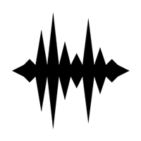

# Sound Physics

<picture>
  <source media="(prefers-color-scheme: dark)" srcset="images/logo_small_dark.png">
  
</picture>

Realistic sound for *Minecraft* 1.7.10: blocks between you and a sound muffle it, caves and large rooms echo, and sounds lose their highs over distance and in snow.

New in this fork:

* Works with [MAtmos](https://github.com/AngelicIndustries/MAtmos): its ambience and item sounds keep their own levels instead of fading with distance or picking up echoes.
* Loud sounds such as thunder and explosions carry as far as they should, and so do sounds whose range another mod sets.
* Other mods can muffle all sounds, as [Enhanced Visuals Legacy](https://github.com/AngelicIndustries/EnhancedVisualsLegacy) does when an explosion goes off next to you or you are drowning.
* Sounds no longer inherit the echo or muffling of the sound that played before them, so paused and resumed ambience comes back clean.

<!-- Not published yet

-->

## Dependencies

* [UniMixins](https://github.com/LegacyModdingMC/UniMixins)   

Client only.

## Building

`./gradlew build`

## Credits

* [Sonic Ether](https://github.com/sonicether/Sound-Physics) for Sound Physics
* [daipenger](https://github.com/daipenger/Sound-Physics) for the 1.12.2 port
* [djpadbit](https://github.com/djpadbit/Sound-Physics/tree/1.7.10-backport) for the 1.7.10 backport, dynamic environment evaluation and stereo down-mixing
* [Mist475](https://github.com/mist475/Sound-Physics) for the mixin rewrite, and [eigenraven](https://github.com/eigenraven) for lwjgl3ify support
* The [GTNH buildscript](https://github.com/GTNewHorizons/ExampleMod1.7.10)

## License

`GPLv3`

## Buy me some creatine

* [ko-fi.com](https://ko-fi.com/jackisasubtlejoke)
* Monero: `893tQ56jWt7czBsqAGPq8J5BDnYVCg2tvKpvwTcMY1LS79iDabopdxoUzNLEZtRTH4ewAcKLJ4DM4V41fvrJGHgeKArxwmJ`
